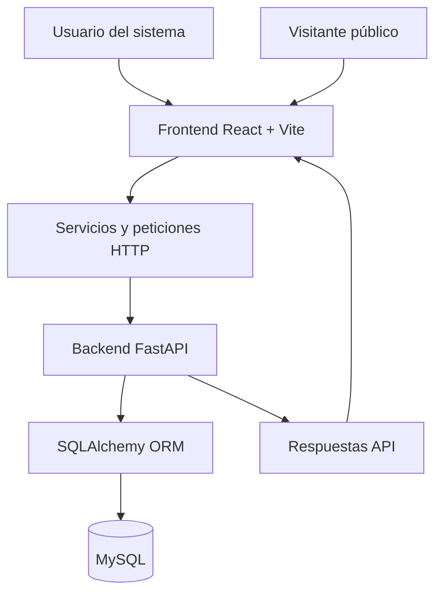

# DOCUMENTACIÓN TÉCNICA
# SABORES DEL LLANO
**Proyecto de práctica profesional universitaria**

| Información | Descripción |
|---|---|
| Nombre del proyecto | Sabores del Llano |
| Tipo | Aplicación web de gestión empresarial |
| Contexto | Práctica profesional universitaria |
| Frontend | React + Vite |
| Backend | Python + FastAPI |
| ORM | SQLAlchemy |
| Base de datos | MySQL |
| Nombre de la base de datos | `sabores_del_llano` |
| Estado | Desarrollo e integración progresiva |
| Última actualización documental | 3 de noviembre de 2026 |

> **Nota sobre la documentación:** Este documento se construyó a partir de las decisiones, información y avances conocidos del proyecto. Las rutas generales y reglas de negocio confirmadas se documentan como referencia. Los nombres exactos de archivos, funciones, endpoints, columnas y relaciones que no se han inspeccionado directamente deben verificarse en el repositorio antes de modificarlos.

---

# 1. DESCRIPCIÓN GENERAL DEL PROYECTO

## 1.1. ¿Qué es Sabores del Llano?

Sabores del Llano es un proyecto de aplicación web orientado a apoyar la gestión administrativa y operativa de un negocio familiar dedicado a la comercialización de productos gastronómicos tradicionales de la región de los Llanos Orientales de Colombia.

Los productos principales contemplados son:

- Hayacas.
- Lechona.

El sistema busca centralizar diferentes procesos del negocio mediante módulos independientes que permitan gestionar pedidos, ventas, producción, inventario, gastos y análisis de información.

También contempla un módulo público para presentar el negocio y ofrecer una calculadora de estimación de precios de lechona.

## 1.2. Objetivo general

Desarrollar una aplicación web que facilite la administración de las operaciones del negocio Sabores del Llano, permitiendo organizar la información comercial y operativa, consultar indicadores, controlar procesos y aprovechar los registros históricos para apoyar la toma de decisiones.

## 1.3. Objetivos específicos

1. Organizar la información de clientes y pedidos.
2. Facilitar el registro y consulta de ventas.
3. Gestionar la producción de los productos comercializados.
4. Registrar sobrantes y movimientos de inventario.
5. Llevar control de gastos y cierres diarios.
6. Presentar información mediante indicadores y gráficos.
7. Incorporar un módulo de predicción de demanda.
8. Considerar el comportamiento de la demanda según fechas, fines de semana y festivos colombianos.
9. Ofrecer una interfaz pública con información del negocio y una calculadora de lechona.

## 1.4. Alcance funcional

El proyecto contempla los siguientes módulos:

| Módulo | Propósito |
|---|---|
| Autenticación | Acceso al sistema |
| Dashboard | Resumen general de la operación |
| Pedidos | Gestión de pedidos individuales |
| Producción y análisis | Registro y consulta de producción y sobrantes |
| Ventas | Gestión del historial comercial |
| Predicción de demanda | Estimación de demanda a partir de información histórica |
| Módulo público | Presentación comercial y calculadora de lechona |

Los módulos adicionales de gastos, inventario y cierres diarios se encuentran contemplados en el diseño de la base de datos. Su estado de implementación en la interfaz debe verificarse.

---

# 2. ARQUITECTURA TECNOLÓGICA

## 2.1. Arquitectura general

El proyecto utiliza una arquitectura frontend-backend con una base de datos relacional.



### Frontend

Responsable de:

- Mostrar las interfaces.
- Gestionar formularios.
- Administrar estados locales.
- Validar datos en el navegador.
- Presentar indicadores y gráficos.
- Enviar solicitudes al backend cuando exista integración.

### Backend

Responsable de:

- Recibir solicitudes.
- Validar información.
- Aplicar reglas de negocio.
- Ejecutar operaciones sobre la base de datos.
- Devolver respuestas al frontend.

### Base de datos

Responsable de almacenar información estructurada del negocio.

## 2.2. Tecnologías

| Tecnología | Función |
|---|---|
| React | Construcción de interfaces |
| Vite | Entorno de desarrollo y compilación frontend |
| JavaScript | Lógica del frontend |
| Python | Lenguaje del backend |
| FastAPI | Construcción de API |
| SQLAlchemy | Acceso y mapeo de datos |
| MySQL | Almacenamiento relacional |

Las versiones exactas deben consultarse en `package.json`, archivos de configuración del backend y dependencias instaladas.

---

# 3. ESTRUCTURA DEL PROYECTO

La estructura general conocida es:

```text
Sabores del llano - Practica profesional/
│
├── src/
│   │
│   ├── features/
│   │   ├── auth/
│   │   ├── orders/
│   │   ├── demand/
│   │   ├── public/
│   │   ├── sales/
│   │   └── [otros módulos]
│   │
│   ├── components/
│   │   └── ui/
│   │
│   ├── [servicios, utilidades y configuración]
│   │
│   └── [archivos principales de React]
│
├── backend/
│   └── [estructura FastAPI]
│
├── package.json
├── [configuración Vite]
├── [archivos de configuración]
└── [documentación]
```

**Importante:** esta es una representación general. El próximo agente debe inspeccionar el repositorio para obtener el árbol completo y los nombres exactos de los archivos.

## 3.1. `src/features/`

Contiene los módulos funcionales del frontend.

La organización por funcionalidades permite mantener separados los procesos de autenticación, pedidos, ventas, predicción y presentación pública.

Cada módulo debe mantener sus responsabilidades y evitar depender innecesariamente de archivos internos de otros módulos.

## 3.2. `src/components/`

Contiene componentes reutilizables de la aplicación.

## 3.3. `src/components/ui/`

Contiene o está destinado a contener componentes visuales reutilizables.

Debe inspeccionarse para identificar:

- Botones.
- Campos de entrada.
- Selectores.
- Tarjetas.
- Modales.
- Componentes de formularios.
- Elementos de interfaz compartidos.

Antes de modificar un componente global, comprobar qué módulos lo utilizan.

## 3.4. `backend/`

Contiene la implementación del servidor.

La estructura interna debe verificarse directamente. Se conoce el uso de FastAPI, SQLAlchemy y MySQL, pero no se documentan nombres de módulos o endpoints sin comprobarlos.

---

# 4. DOCUMENTACIÓN FUNCIONAL DEL FRONTEND

# 4.1. Módulo de autenticación

Ruta conocida:

`src/features/auth/pages/LoginPage.jsx`

Este módulo contiene la pantalla de inicio de sesión.

Se ha trabajado sobre los siguientes elementos:

- Formulario de acceso.
- Interacción de los campos.
- Opción «Recordar credenciales de acceso».
- Checkbox para activar y desactivar esa opción.

### Ajuste solicitado

Se detectó que la animación del checkbox no funcionaba correctamente.

Se solicitó corregir exclusivamente la animación, sin modificar el comportamiento de autenticación ni el almacenamiento de credenciales.

**Estado de implementación:** pendiente de comprobación en el código actual.

El próximo agente debe verificar:

- Cómo se administra el estado del checkbox.
- Si existe persistencia de credenciales.
- Si la autenticación está conectada con FastAPI.
- Qué mecanismo se utiliza para gestionar la sesión.

No asumir que el inicio de sesión es completamente funcional sin revisar su integración.

---

# 4.2. Dashboard

El dashboard constituye la vista general del sistema.

Se conoce la presencia del saludo:

«¡Buenos días, Doña Martha!»

Se estableció como criterio visual que este título debe tener el mismo tamaño de fuente que los encabezados principales de:

- Pedidos.
- Producción y Análisis.
- Ventas.
- Predicción de demanda.

Se solicitó igualar exclusivamente el tamaño, conservando tipografía, peso, colores y demás propiedades visuales.

**Estado:** verificar implementación.

El próximo agente debe identificar:

- Componente principal.
- Indicadores mostrados.
- Gráficos.
- Fuentes de información.
- Dependencias con los demás módulos.
- Información estática y dinámica.

---

# 4.3. Módulo de pedidos

Ruta:

`src/features/orders`

Este módulo administra los pedidos individuales de los clientes.

## Funcionalidades contempladas

- Visualización de pedidos.
- Creación de nuevos pedidos.
- Identificación del cliente.
- Selección del producto.
- Cantidad.
- Fecha del pedido.
- Fecha de entrega.
- Estado del pedido.
- Modalidad de entrega.

## Formulario «+ Nuevo pedido»

Se han establecido las siguientes decisiones:

### Cliente

El campo debe permitir escribir libremente el nombre del cliente.

No se desea una lista desplegable de clientes ni sugerencias de autocompletado.

La razón es evitar listas extensas que puedan dificultar y ralentizar el ingreso de pedidos.

### Modalidad de entrega

Se contemplan las modalidades disponibles en el formulario, incluyendo:

- Recogida en establecimiento.
- Domicilio.

Cuando se selecciona domicilio deben aparecer:

1. Dirección de entrega.
2. Número de teléfono.

Cuando se selecciona otra modalidad, ambos campos deben ocultarse.

Los valores deben comportarse coherentemente cuando el usuario cambia de modalidad.

### Diseño de la modalidad

Se solicitó invertir los colores de la opción de entrega:

- Fondo verde.
- Texto blanco.

El tono verde debe corresponder al color que anteriormente tenía el texto.

No deben modificarse las dimensiones ni el resto de la presentación.

### Restricciones

Los pedidos son individuales.

No se deben generar pedidos masivos ni pedidos de eventos para ampliar artificialmente los datos históricos.

**Estado:** verificar en los componentes actuales qué ajustes se encuentran aplicados y cuáles tienen persistencia real.

---

# 4.4. Módulo de producción y análisis

Este módulo está orientado al seguimiento de la producción de los productos comercializados.

Debe contemplar:

- Cantidades producidas.
- Cantidades vendidas.
- Sobrantes.
- Información por fecha.
- Información por producto.
- Indicadores de producción.
- Análisis de comportamiento.

## Regla fundamental

Se confirmó la siguiente relación:

`Producción = Ventas + Sobrantes`

Por ejemplo:

| Concepto | Hayacas |
|---|---:|
| Ventas | 127 |
| Sobrantes | 16 |
| Producción | 143 |

Los datos originales del Excel presentaban una inconsistencia porque la producción registrada coincidía con las ventas incluso cuando existían sobrantes positivos.

La interpretación confirmada fue que la producción estaba incompleta.

Por tanto, la producción corregida se reconstruye sumando las ventas y los sobrantes.

El próximo agente debe respetar esta regla al trabajar con producción e inventario.

No asumir que el módulo ya tiene conexión con la base de datos: verificarlo.

---

# 4.5. Módulo de ventas

Ubicación conocida:

`src/features/sales`

El módulo está destinado a gestionar las operaciones comerciales.

Debe contemplar:

- Fecha de venta.
- Producto.
- Presentación.
- Cantidad.
- Precio unitario.
- Total de venta.
- Historial.
- Indicadores.
- Filtros y consultas.

## Productos y precios de referencia

| Producto | Unidad base | Precio de referencia |
|---|---|---:|
| Hayaca | Unidad | $10.000 COP |
| Lechona | Plato | $12.000 COP |

Estos valores proceden del conjunto de datos suministrado para el proyecto.

Deben verificarse antes de considerarse tarifas históricas aplicables a todos los periodos.

El próximo agente debe revisar si el módulo utiliza datos estáticos o si tiene persistencia real mediante FastAPI.

---

# 4.6. Módulo de predicción de demanda

Ruta:

`src/features/demand`

Este módulo tiene como finalidad permitir la estimación de la demanda de los productos del negocio a partir de información histórica.

El profesor solicitó que la selección del periodo histórico permita analizar un rango personalizado de fechas.

## Configuración de estimación

La interfaz contempla:

1. Producto.
2. Periodo histórico.
3. Horizonte de estimación.

### Producto

Se permite seleccionar el producto que se desea analizar.

### Periodo histórico

Se acordó sustituir el selector anterior por dos fechas:

- `fechaDesde`
- `fechaHasta`

El usuario debe poder elegir un rango personalizado.

Validaciones acordadas:

- La fecha inicial no puede ser posterior a la fecha final.
- La fecha final no puede ser anterior a la fecha inicial.
- Los rangos inválidos deben mostrar un mensaje.
- No se ha definido todavía un mínimo obligatorio de días.

La definición del rango histórico mínimo debe establecerse junto con la lógica del backend y la evaluación del modelo.

### Horizonte de estimación

La interfaz contempla la selección del horizonte que se desea estimar.

El valor y las opciones exactas deben verificarse en el código.

### Generar estimación

El botón debe utilizar los parámetros seleccionados para solicitar una estimación.

No debe afirmarse que existe un modelo predictivo funcional hasta verificar:

- La lógica matemática o estadística.
- Los datos de entrada.
- El servicio backend.
- Los resultados.
- Las métricas de evaluación.

## Requerimiento académico

El profesor solicitó considerar factores que pueden influir en la demanda, entre ellos:

- Festivos colombianos.
- Vacaciones escolares.
- Festividades locales.
- Temporadas de fin de año.
- Eventos relevantes.
- Variaciones de demanda según fechas.

Estos factores deben incorporarse con información verificable y reglas justificadas.

No se deben inventar eventos ni atribuirles efectos históricos no demostrados.

---

# 4.7. Módulo público

Ruta:

`src/features/public`

Este módulo contiene la parte pública del sitio.

Se conoce una calculadora destinada exclusivamente a estimar precios de lechona.

## Calculadora de lechona

La calculadora tiene una barra deslizante para seleccionar el número de comensales.

El usuario debe poder moverla y observar cómo cambia automáticamente el presupuesto estimado.

### Precios confirmados por el usuario

| Presentación | Precio |
|---|---:|
| Plato individual | $12.000 COP |
| Cojín pequeño para 25 personas | $320.000 COP |
| Cojín para 50 personas | $520.000 COP |

### Fórmula provisional acordada

Para cantidades entre 5 y 25 personas:

Interpolación lineal entre:

- 5 personas: $60.000.
- 25 personas: $320.000.

Para cantidades entre 25 y 50:

Interpolación lineal entre:

- 25 personas: $320.000.
- 50 personas: $520.000.

Para cantidades superiores a 50:

Incremento provisional de $8.000 por persona adicional.

### Valores esperados

| Personas | Precio estimado |
|---:|---:|
| 5 | $60.000 |
| 10 | $125.000 |
| 25 | $320.000 |
| 50 | $520.000 |
| 100 | $920.000 |
| 150 | $1.320.000 |

Los valores superiores a 50 personas son estimaciones matemáticas y no precios comerciales confirmados.

### Interacción esperada

- Barra deslizante entre 5 y 150 personas.
- Actualización inmediata del número de personas.
- Actualización inmediata del precio.
- Botones rápidos de 10, 25, 50 y 100 personas.
- Actualización simultánea de la tarjeta de recomendación.
- Formato monetario COP.

La tarjeta debe mostrar una recomendación coherente con la cantidad seleccionada, sin presentar nombres de presentaciones comerciales no confirmadas.

**Estado:** verificar si la lógica ya fue implementada o si la calculadora sigue utilizando valores estáticos.

---

# 5. BACKEND

## 5.1. Tecnologías conocidas

- Python.
- FastAPI.
- SQLAlchemy.
- MySQL.

Se conoce que se preparó una estructura inicial de backend y que se trabajó en la conexión con MySQL.

También se indicó que el proyecto llegó a conectarse correctamente a la base de datos.

No obstante, el estado actual de endpoints, modelos y servicios debe comprobarse en el repositorio.

## 5.2. Aspectos que deben inspeccionarse

El siguiente agente debe identificar:

- Archivo de entrada de FastAPI.
- Configuración.
- Variables de entorno.
- Conexión a MySQL.
- Motor SQLAlchemy.
- Gestión de sesiones.
- Modelos ORM.
- Esquemas Pydantic.
- Rutas.
- Servicios.
- Validaciones.
- CORS.
- Health checks.
- Pruebas.

## 5.3. Seguridad

No exponer:

- Contraseñas.
- Tokens.
- Secretos.
- Credenciales de MySQL.

El archivo `.env` real debe permanecer fuera del control de versiones.

El archivo `.env.example` debe documentar las variables necesarias sin incluir valores sensibles.

---

# 6. BASE DE DATOS

Nombre:

`sabores_del_llano`

El diseño inicial contempla 12 tablas:

| Tabla | Propósito |
|---|---|
| clientes | Información de clientes |
| usuarios | Usuarios del sistema |
| productos | Catálogo de productos |
| presentaciones | Presentaciones comerciales |
| pedidos | Encabezados de pedidos |
| detalle_pedidos | Productos y cantidades de cada pedido |
| ventas | Encabezados de ventas |
| detalle_ventas | Productos y cantidades de cada venta |
| producciones | Registros de producción |
| movimientos_inventario | Movimientos de inventario |
| cierres_diarios | Resumen de operaciones por día |
| gastos | Registro de gastos |

Esta lista corresponde al diseño inicial conocido. El siguiente agente debe comprobar las tablas y columnas del esquema MySQL actual.

## 6.1. Relaciones conceptuales

El modelo de negocio contempla las siguientes relaciones:

- Un cliente puede realizar varios pedidos.
- Un pedido puede contener varios detalles.
- Cada detalle de pedido corresponde a un producto y una cantidad.
- Una venta puede contener varios detalles.
- Los productos se relacionan con sus presentaciones.
- La producción se registra por producto y fecha.
- Los movimientos de inventario permiten registrar entradas y salidas.
- Los cierres diarios consolidan información de operación.
- Los gastos registran egresos del negocio.

Estas son relaciones conceptuales; deben verificarse contra las claves foráneas reales.

## 6.2. Restricciones conocidas

Durante la creación inicial del esquema se identificó una restricción CHECK en movimientos de inventario que se retiró manualmente.

La validación de los tipos de origen de movimientos debía implementarse posteriormente en FastAPI.

El próximo agente debe verificar el estado actual de esta validación antes de realizar cambios.

---

# 7. DATOS HISTÓRICOS Y EXCEL

Se trabajó con archivos Excel proporcionados por el usuario.

El archivo depurado conocido fue:

`Datos_sabores_del_llano_depurado.xlsx`

Se generó a partir del archivo original:

`Datos sabores del llano.xlsx`

Posteriormente se proporcionó otro archivo llamado:

`Sabores del llano.xlsx`

Su contenido y estado deben comprobarse antes de utilizarlo como fuente de importación.

## 7.1. Hojas del Excel depurado conocido

1. Resumen depuración.
2. Productos.
3. Ventas.
4. Pedidos.
5. Producción depurada.
6. Sobrantes originales.

## 7.2. Datos originales identificados

Periodo:

6 de junio de 2026 al 31 de octubre de 2026.

Se identificaron:

- 98 registros de ventas.
- 211 pedidos.
- 98 registros de producción reconstruida.
- 98 registros de sobrantes.

El historial de ventas contenía dos productos por fecha.

Se identificaron 49 fechas de operación.

El total de ventas registrado en el Excel fue de $136.290.000 COP.

La fila «Total General» se excluyó de los registros de ventas porque era un resumen y no una operación individual.

## 7.3. Producción reconstruida

Se aplicó:

`Producción corregida = Ventas + Sobrantes`

En el archivo depurado se conservaron los valores originales para mantener trazabilidad.

Los valores reconstruidos no deben confundirse con registros originales verificados.

## 7.4. Ampliación histórica pendiente

Se acordó ampliar el periodo desde:

1 de noviembre de 2024 hasta 31 de octubre de 2026.

Los nuevos registros deben cumplir:

- Fechas de ventas únicamente sábados, domingos y festivos nacionales colombianos.
- Cantidades basadas en los rangos observados.
- Reducción histórica aproximada del 5 % al 8 % anual respecto al nivel de referencia de 2026.
- Pedidos individuales.
- Clientes ficticios para registros sintéticos.
- Producción igual a ventas más sobrantes.
- Identificación explícita de datos sintéticos.

No se debe afirmar que la ampliación ya está realizada hasta verificar el archivo correspondiente.

## 7.5. Identificación de registros sintéticos

Se recomienda utilizar:

- `Es_sintetico`
- `Origen_dato`
- `Observacion`

Los registros originales deben conservar su identificación.

Los sintéticos no deben utilizarse como si fueran observaciones reales para demostrar la precisión del modelo predictivo.

---

# 8. REGLAS DE NEGOCIO

Estas reglas deben respetarse durante el desarrollo.

## Productos

- Hayaca: unidad base Unidad.
- Lechona: unidad base Plato.
- Presentación individual.
- Precios de referencia: $10.000 y $12.000 respectivamente.

## Pedidos

- Solo pedidos individuales.
- No crear pedidos masivos.
- No inventar eventos.
- Las fechas de entrega deben corresponder a días permitidos.
- No asumir que un pedido entregado equivale automáticamente a una venta.

## Ventas

Las fechas permitidas son:

- Sábados.
- Domingos.
- Festivos nacionales oficiales de Colombia.

No confundir festividades locales con festivos nacionales.

## Producción

`Producción = Ventas + Sobrantes`

## Datos sintéticos

Deben estar identificados claramente.

No mezclarlos silenciosamente con datos reales.

## Predicción

La selección del periodo histórico debe permitir un rango personalizado.

El mínimo de días todavía debe definirse con fundamento técnico.

La predicción debe considerar la disponibilidad y calidad de los datos.

---

# 9. ESTADO DE LOS MÓDULOS

La siguiente tabla representa el conocimiento disponible y no sustituye una auditoría del código.

| Módulo | Trabajo conocido | Estado real |
|---|---|---|
| Autenticación | Interfaz de inicio de sesión y checkbox de recordar credenciales | Por verificar |
| Dashboard | Vista general y saludo principal | Por verificar |
| Pedidos | Formulario de nuevo pedido y modalidad de entrega | Por verificar |
| Producción | Diseño funcional y regla de producción | Por verificar |
| Ventas | Módulo de ventas | Por verificar |
| Demanda | Selector de rango histórico y configuración | Por verificar |
| Público | Calculadora de lechona | Por verificar |
| Backend | Estructura FastAPI y conexión MySQL trabajadas | Por verificar |
| Base de datos | Esquema inicial de 12 tablas | Por verificar |

---

# 10. CONFIGURACIÓN Y EJECUCIÓN

Los comandos exactos deben verificarse en el repositorio.

Como referencia, el frontend utiliza Vite y normalmente se inicia desde la carpeta raíz mediante los scripts definidos en `package.json`.

El backend utiliza FastAPI y debe ejecutarse desde su entorno Python correspondiente.

El siguiente agente debe revisar:

- Scripts disponibles en `package.json`.
- Dependencias del backend.
- Archivo de entrada FastAPI.
- Variables de entorno.
- Configuración MySQL.
- Puerto y URL de la API.
- CORS.

No asumir puertos ni comandos específicos sin inspeccionar los archivos de configuración.

---

# 11. DECISIONES DE DESARROLLO

Las siguientes decisiones deben respetarse:

1. Trabajar módulo por módulo.
2. Resolver un detalle antes de pasar al siguiente.
3. No modificar funcionalidades ajenas a la tarea.
4. Evitar refactorizaciones innecesarias.
5. Conservar la identidad visual.
6. No cambiar backend por solicitudes exclusivamente visuales.
7. No cambiar la base de datos sin autorización.
8. Identificar los datos sintéticos.
9. No inventar reglas de negocio.
10. Solicitar autorización antes de modificar estructuras importantes.
11. Verificar los resultados antes de continuar.

## 11.1. Historial de ajustes solicitados

Se han solicitado los siguientes cambios:

- Animación del checkbox de recordar credenciales.
- Campo de cliente de escritura libre.
- Inversión de colores en modalidad de entrega.
- Uniformidad de tamaño de títulos.
- Campo de teléfono para domicilios.
- Selector de periodo histórico Desde/Hasta.
- Corrección de alineación en configuración de estimación.
- Calculadora pública interactiva de lechona.

La implementación de cada cambio debe verificarse en el código.

---

# 12. PLAN DE CONTINUACIÓN

## Fase 1. Finalización del frontend

- Auditar los ajustes solicitados.
- Revisar formularios.
- Verificar interacciones.
- Identificar datos estáticos.
- Corregir detalles visuales pendientes.

## Fase 2. Preparación de datos

- Verificar el Excel más reciente.
- Diferenciar datos originales y sintéticos.
- Validar fechas.
- Validar producción.
- Validar sobrantes.
- Revisar pedidos.
- Preparar importación.

## Fase 3. Backend

- Revisar estructura existente.
- Completar modelos.
- Completar esquemas.
- Implementar endpoints.
- Aplicar validaciones.
- Integrar módulos.

## Fase 4. Integración

- Conectar pedidos.
- Conectar ventas.
- Conectar producción.
- Conectar inventario.
- Conectar gastos.
- Conectar dashboard.

## Fase 5. Predicción

- Preparar datos históricos.
- Definir variables.
- Establecer periodo mínimo.
- Considerar festivos.
- Considerar temporadas.
- Implementar modelo.
- Evaluar resultados.
- Integrar con frontend.

## Fase 6. Pruebas y entrega

- Pruebas integrales.
- Validación de datos.
- Revisión de seguridad.
- Documentación de usuario.
- Preparación de entrega universitaria.

---

# 13. INSTRUCCIONES IMPORTANTES PARA EL AGENTE QUE CONTINÚE EL PROYECTO

Este proyecto debe continuar de forma ordenada.

Antes de modificar código:

1. Leer esta documentación.
2. Leer `RESUMEN_TRANSFERENCIA.md`.
3. Inspeccionar el repositorio.
4. Comparar documentación y código.
5. Identificar el estado real.
6. Explicar qué archivos se modificarían.
7. Esperar autorización cuando el cambio afecte estructuras importantes.

No asumir que una funcionalidad está terminada solo porque aparece descrita en este documento.

No modificar archivos que no estén relacionados con la tarea.

No cambiar reglas de negocio sin consultar al usuario.

No modificar MySQL o FastAPI cuando se solicite únicamente un ajuste visual.

Mantener separados los datos reales y sintéticos.

No realizar importaciones destructivas.

Priorizar cambios pequeños y verificables.

**El usuario dirige el orden de desarrollo y valida los resultados antes de avanzar a la siguiente tarea.**

---

# 14. ALCANCE Y LIMITACIONES DE ESTA DOCUMENTACIÓN

Este documento se elaboró utilizando el contexto y las decisiones conocidas del proyecto.

No constituye una auditoría directa de todos los archivos fuente.

Por tanto, deben verificarse en el repositorio:

- Versiones exactas.
- Árbol completo de archivos.
- Nombres de componentes.
- Endpoints.
- Modelos ORM.
- Columnas SQL.
- Relaciones.
- Estado real de integración.
- Pruebas.
- Configuración de ejecución.

La documentación debe actualizarse cuando se comprueben estos elementos.

**Fin del documento.**